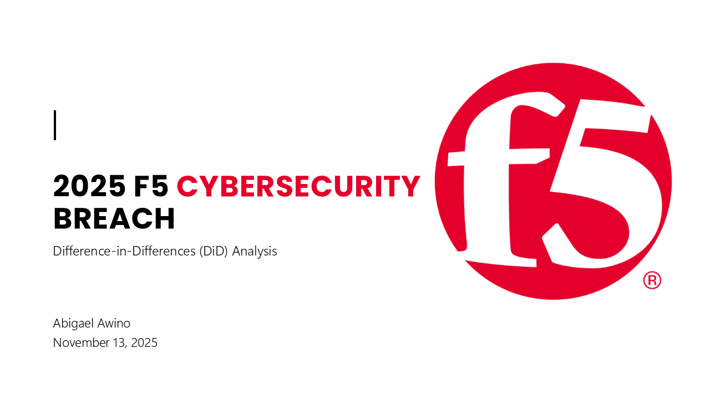
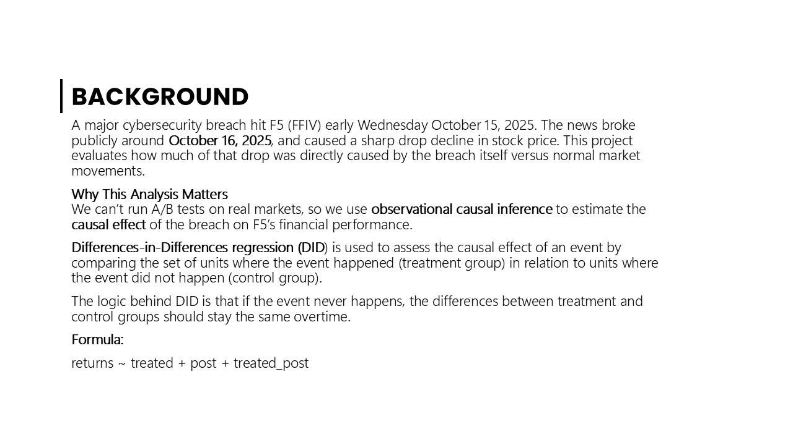
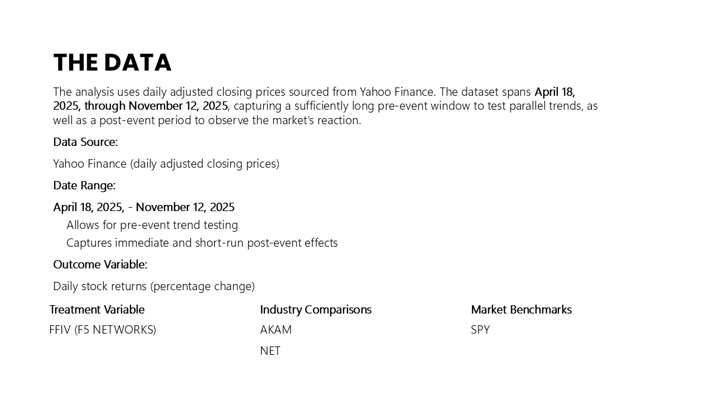
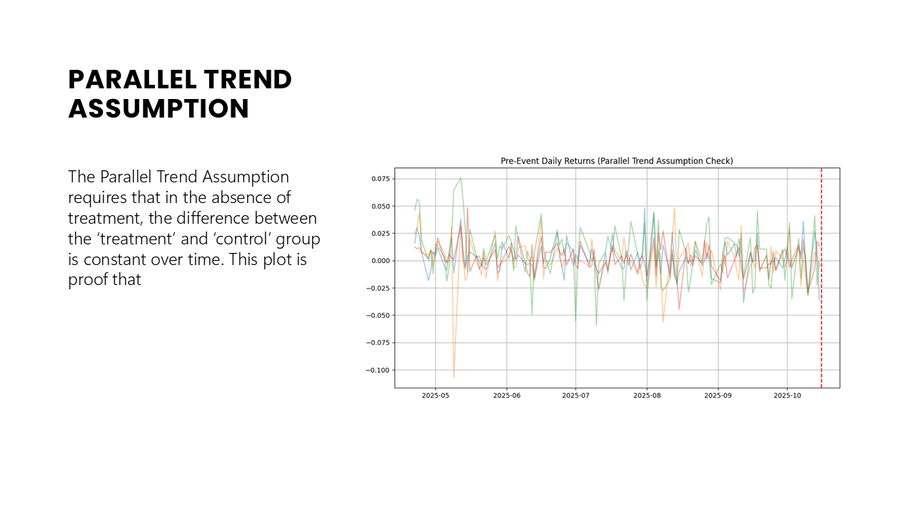
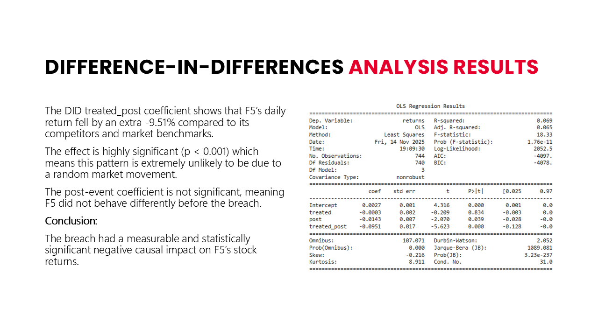
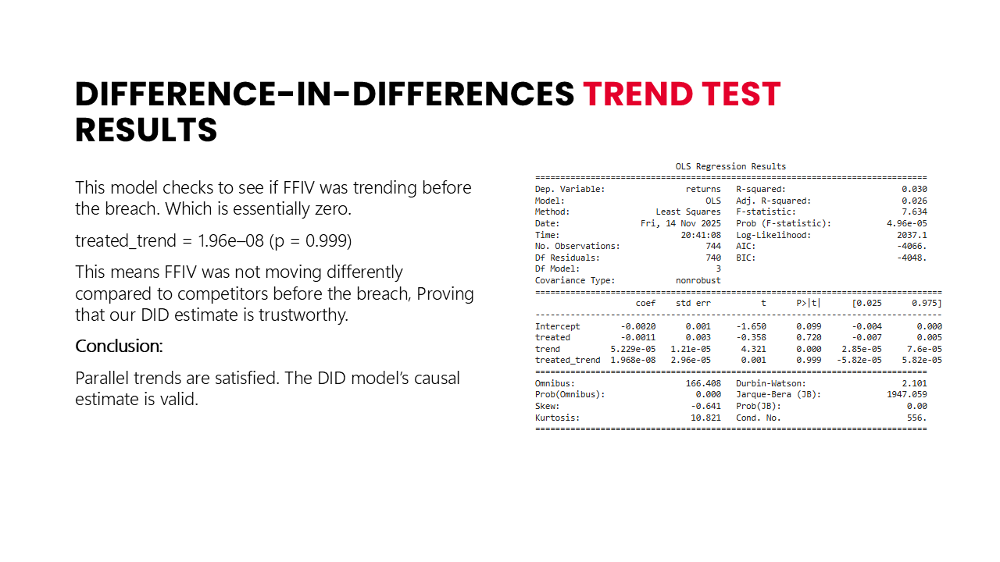
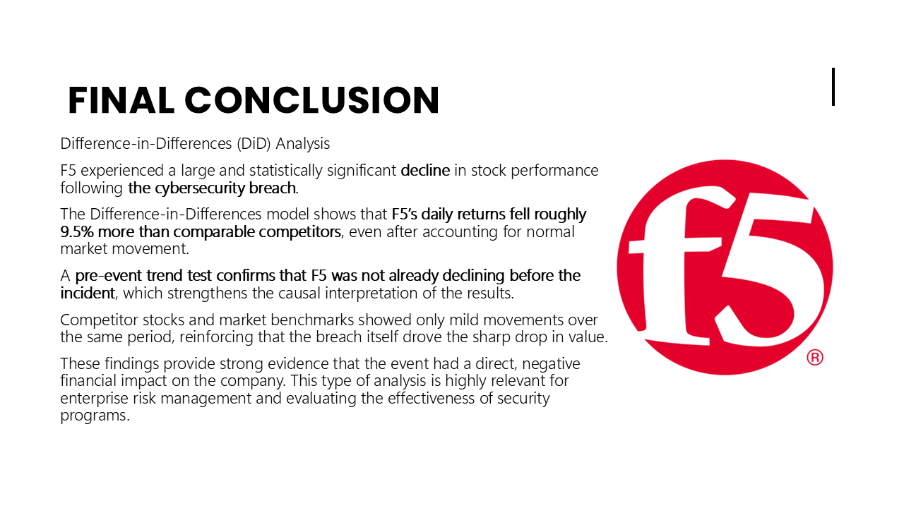

# Causal Impact of the 2025 F5 Networks Cybersecurity Breach  
### Difference-in-Differences Analysis of Stock Market Reaction

This project analyzes the causal impact of the **October 2025 cyber breach at F5 Networks (FFIV)** using **causal inference techniques** — specifically a **Difference-in-Differences (DiD)** model and a **Difference-in-Trends** robustness test.

Because real stock markets cannot be A/B tested, DiD provides a credible way to estimate what portion of the price impact was caused by the breach itself.

---

## Slide 1 – Overview

---

## Slide 2 – Background

---

## Slide 3 – The Data

---

## Slide 4 – Parallel Trend Assumption

---

## Slide 5 – Difference-in-differences analysis results

---

## Slide 6 – Difference-in-differences analysis Trend Test results  

---

## Slide 7 – Final Conclusion

## Data Sources

All stock data comes from **Yahoo Finance** pulled using the `yfinance` API.

**Time Window**
- Start: **2025-04-18**  
- End: **2025-12-12**  
- Event Date: **2025-10-16**

**Tickers Used**

| Group | Ticker | Description |
|-------|--------|-------------|
| Treated | **FFIV** | F5 Networks |
| Competition | AKAM | Akamai |
|            | NET | Cloudflare |
|            | CSCO | Cisco |
| Benchmarks | SPY | S&P 500 ETF |
|            | VTI | Total Market ETF |

---

## Methodology

### 1. Compute Daily Returns  
returns ~ treated + post + treated_post
Where:

- **treated = 1** for FFIV  
- **post = 1** on/after event date  
- **treated_post = treated × post**  
- The coefficient on `treated_post` is the **causal effect**  

Post window: **30 days** after the event for the headline estimate, with a 90-day window as a fade check. Pre window: 180 days before the event.

### 3. Validity Checks  
To ensure a credible estimate:
**Parallel Trends Check**, **Placebo Test (fake event Sep 16, 2025 — a month earlier, so its window ends before the real event)**, **Difference-in-Trends robustness model**

---

## Key Findings

### Correction (Nov 2025)
The first version of this analysis filtered the data to `date <= event_date`, so the "post" period was only the event day itself and the headline coefficient (-0.0951) was a one-day event comparison, not a sustained effect. The model was re-run with a real 30-day post window. The results below are the corrected ones.

### Main Result  
On the announcement day (Oct 16, 2025), F5 fell **10.7%**, while peers fell 0.6–2.8% (Akamai -1.0%, Cisco -0.6%, Cloudflare -2.8%, S&P 500 -0.7%).

Over the **30 days after the breach**, F5 underperformed its peers by **1.8 percentage points per day on average**:
treated_post = -0.0176 (p < 0.001)

Over longer windows the effect faded: 60-day treated_post = -0.0063 (p = 0.067), 90-day = -0.0053 (p = 0.085), full window to Dec 12 = -0.0066 (p = 0.057) — none significant. The market punished F5 hard for about a month, then moved on.

### Additional observations
- `treated` not significant → FFIV behaved similarly to peers before the event  
- `post` not significant over the 30-day window → no broad market dip after the event  
- Placebo test (fake Sep 16 event): no significance (p = 0.67) → supports causal validity  
- Parallel trends check: no evidence trends differed before the event (p = 0.38)  

---

## Visualizations Included

- Daily returns for all tickers  
- Event impact line  
- Pre-event trends for assumption checking  
- Placebo effect graph  
- Robustness trend model  

---

## Code Structure

### Data Collection  
- `get_daily_prices()`  
- `get_prices()`  

### Models  
- `run_diff_in_diff()` — now takes a `post_days` argument (default 30)  
- `difference_in_trends()`  
- Placebo test  

### Plotting  
- Event impact visualizations  
- Trend diagnostics  

Packages used:
- pandas  
- numpy  
- matplotlib  
- statsmodels  
- yfinance  

---

## Why This Matters

Cybersecurity failures have **material financial impact**.  
This project demonstrates how data science + causal inference can support:

- Risk management  
- Cyber impact assessment  
- Investor relations  
- Executive reporting  
- Strategic decision-making  

---

## Future Extensions

- Add volatility + volume impact  
- Use intraday prices for precision  
- Consider a Bayesian structural time-series model  
- Expand competitor set using clustering  
